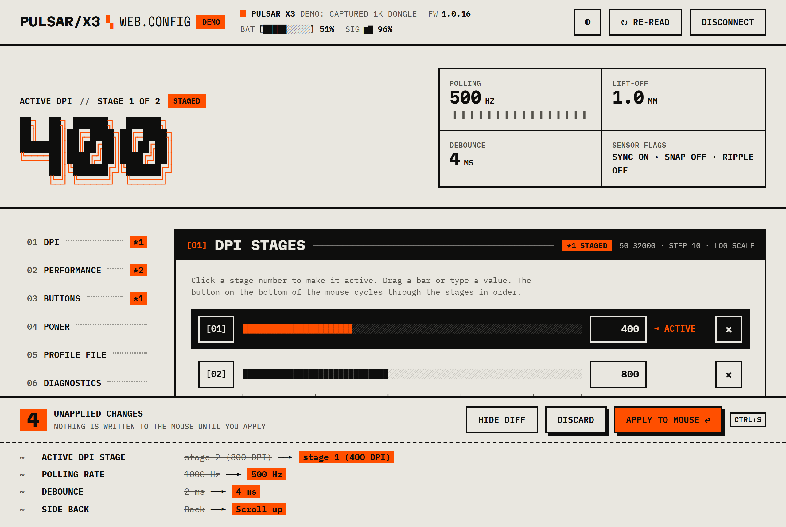

<h1 align="center">PULSAR/X3 ▚ WEB.CONFIG</h1>

<p align="center">
  An educational project: a study of how a gaming mouse's configuration protocol works, and of driving it from a browser tab over <a href="https://developer.mozilla.org/en-US/docs/Web/API/WebHID_API">WebHID</a>.<br>
  It can read and change the settings of a Pulsar X3 without any vendor software, background service or network access.
</p>

<p align="center">
  <b><a href="https://santoshpanna.github.io/Pulsar-X3-Medium---Web-Config/">Open the web config</a></b>
  ·
  <a href="https://santoshpanna.github.io/Pulsar-X3-Medium---Web-Config/?demo">Try the demo (no mouse needed)</a>
  ·
  <a href="https://github.com/santoshpanna/Pulsar-X3-Medium---Web-Config/issues">Report an issue</a>
</p>

> [!IMPORTANT]
> **Unofficial, educational, use at your own risk.** This project is not made, endorsed,
> supported or reviewed by Pulsar Gaming Gears, and is in no way related to or affiliated
> with Pulsar. "Pulsar" and "X3" are used only to name the hardware this code talks to.
> The protocol was worked out independently for learning purposes. The software is
> provided **as is**, without warranty of any kind. Writing to a device's configuration
> memory can leave it misconfigured; you use it entirely at your own risk.

<p align="center">
  
  
  
  
  <a href="LICENSE"></a>
</p>

<p align="center">
  
</p>

## What it does

| Section | What you can change |
|---|---|
| **01 DPI** | 1 to 6 stages, 50 to 32 000 DPI in steps of 10, and which stage is active. Log-scale sliders, typed values, presets |
| **02 Performance** | Polling rate (with the report interval for each), lift-off distance, debounce, motion sync, angle snapping, ripple control |
| **03 Buttons** | All five buttons plus the DPI button: mouse actions, scroll, DPI and profile actions, media keys, or any keyboard shortcut. Pick a button on a drawing of the mouse, press the keys, the page records them |
| **04 Power** | Sleep timer, Low Power Mode threshold, drawn against the live battery level |
| **05 Profile file** | Export everything as JSON; import (or drop) a file back as a reviewable draft |
| **06 Diagnostics** | A live trace of every 64-byte HID feature report, and a hold-to-confirm factory reset |

The header shows the paired mouse, firmware, battery and a sparkline of the dongle's link quality.

### Edits are staged, then applied

Nothing is written while you click around. Every edit goes into a draft. The edited control,
its section and its side-nav entry get a `*` marker, and a bar pinned to the bottom of the
page lists exactly what will change:

```
 4  UNAPPLIED CHANGES                       [HIDE DIFF] [DISCARD] [APPLY TO MOUSE ⏎] CTRL+S
- - - - - - - - - - - - - - - - - - - - - - - - - - - - - - - - - - - - - - - - - - - - - -
 ~  ACTIVE DPI STAGE   stage 2 (800 DPI) ──► stage 1 (400 DPI)
 ~  POLLING RATE       1000 Hz ──► 500 Hz
 ~  DEBOUNCE           2 ms ──► 4 ms
 ~  SIDE BACK          Back ──► Scroll up
```

**Apply** writes only the changed registers, with a progress bar, then reads everything
back so the page shows what the mouse really kept. The bar then turns into
**Applied 4 changes · Revert**: one click puts the previous values back, and only for
those fields, so anything you changed since (or changed on the mouse itself) is left alone.
If the mouse falls asleep mid-apply, the draft is kept and can be applied again once it wakes.
**Re-read** also keeps your staged edits and re-bases them onto what the mouse reports.

| Key | Does |
|---|---|
| `Ctrl` + `S` or `Ctrl` + `Enter` | Apply the draft |
| `Esc` | Cancel key recording, or a typed DPI value |
| Arrow keys on a slider | Step it (every slider is a real range input under its ASCII bar) |
| Hold `Space` or `Enter` | Confirm the factory reset (same as holding the mouse button) |

## Quick start

```sh
npm install
npm run dev        # http://localhost:5173
```

1. Open the page in **Chrome, Edge or another Chromium browser**. WebHID needs `localhost` or HTTPS.
2. Close **Pulsar Fusion** if it is running: it re-applies its own saved settings when it starts, and it holds the dongle open.
3. Move the mouse so it is awake (the idle timer defaults to 30 s), click **Connect mouse** and pick **1K Dongle** (or the X3 itself when wired). The grant is remembered for that origin, so later visits connect on their own.
4. Watch the connection log fill in, edit, review the bar, **Apply**.

No mouse at hand? Click **Run demo**, or open `http://localhost:5173/?demo`. The whole page
then runs against a fake mouse built from frames captured on a real X3; writes are
remembered for the session.

## Compatibility

| Device | VID:PID | Status |
|---|---|---|
| X3 through the 1K wireless dongle | `3710:5402` | **Verified**: every register read, written, read back and restored on real hardware ([report](docs/validation-2026-10-13.json)) |
| X3 wired | `3710:3409`, `3710:3410` | Same protocol, not tested here |
| X3 through the 8K dongle | `3710:5403` | Same protocol, unlocks 2K to 8K polling, not tested here |
| Xlite v4, X2A v3, X2A | `3710:3401`, `3710:3404`, `3710:1404` | Same Fusion2 register map, not tested here |

Firefox and Safari do not implement WebHID; the page says so and offers the demo instead.
Polling rates the connected receiver cannot do are shown struck through, with the reason.

## Privacy

The page makes no network requests of its own. Fonts (IBM Plex Mono, Martian Mono) are
bundled from npm and served with the site, the profile file is built in the browser,
and the theme choice is the only thing kept in `localStorage`.

## Troubleshooting (Windows / Chrome)

| Symptom | Cause | Fix |
|---|---|---|
| `Failed to write the feature report` on every entry | Something else holds the dongle open: Pulsar Fusion, another tab or window running this page, or a script using hidapi. Chrome then only gets a read-only handle. | Close the other user of the dongle and reconnect. |
| Same error right after a page reload | The previous page did not release its HID handle, and Windows wedges the dongle in that browser session. The app closes on `pagehide`, so this should be rare. | Unplug the dongle, plug it back in, reconnect. |
| Chooser shows two "1K Dongle" entries | The dongle exposes two identical vendor interfaces. Only one answers; writing to the other fails with a Windows "device not functioning" error. | Pick either. The app probes both and keeps the one that replies. |
| Page says "The mouse is asleep" | The dongle answers "pending" forever while the mouse sleeps. | Move the mouse. The page retries every two seconds and keeps your draft. |
| Permission prompt again after changing port | WebHID grants are per origin, and `localhost:5173` and `localhost:5174` are different origins. | Stay on one port, or grant again. |

## Deploy as a website

`npm run build` writes a static site to `dist/`. Host it on any HTTPS static host:
GitHub Pages, Cloudflare Pages, Netlify. The included workflow
([pages.yml](.github/workflows/pages.yml)) tests, builds and publishes to GitHub Pages on
every push to `main` once Pages is enabled for the repository with the "GitHub Actions"
source.

## Development

```sh
npm test            # vitest: framing, dongle handshake, exact bytes on the wire, draft diff /
                    # apply / revert against the demo mouse, rendering and action wiring
npm run build       # tsc --noEmit && vite build
```

There is no UI framework. Views are functions that return escaped HTML; a small DOM differ
applies them, so the page can re-render on every slider tick without losing focus, an
in-progress drag, or a running animation.

```
  DOM event ──► Router ──► action handler ──► ctx.stage() / ctx.device.apply() / …
                  ▲         (named in markup:               │
                  │          data-click="dpi.add")          ▼
                  │                                Store<AppState>  ◄── Controller (HID I/O)
                  │                                         │
                  └──── morph(#app) ◄── renderApp(state) ◄──┘  once per animation frame
```

### Layout

```
src/protocol/           talking to the mouse; no DOM
  packet.ts             64-byte frame: build, checksum, parse
  transport.ts          serialised request/answer exchange with pending polling
  device.ts             register map: every getter and setter
  buttons.ts            button binding vocabulary and HID key table
  webhid.ts             device chooser, collection probing, unsolicited reports
  captured.ts           frames captured from a real X3; the stateful demo mouse

src/ui/
  app.ts                wiring: store + controller + router + render loop, Ctrl+S, theme
  controller.ts         connect / boot log / wake watch / apply / revert / import / export
  settings.ts           Settings model: read, diff, plan writes, revert, profile files
  state.ts              AppState, the phases (idle, connecting, live, asleep), selectors
  store.ts              a tiny observable store
  context.ts            Ctx: what every action handler receives
  view.ts               composes the page from the pieces below
  components.ts         primitives: ASCII bar + slider, segmented control, toggle, chip
  keycapture.ts         keydown → button binding (pure, tested)
  dom/                  html`` templating, morph (DOM differ), event Router
  ascii/                figlet lettering (text and SVG), bars, sparklines, DPI log scale
  chrome/               header, hero, side nav, staged-changes dock, toast, footer
  screens/              connect, connection log, asleep, no-WebHID
  sections/             one file per numbered panel, plus the registry (index.ts)

src/styles/             tokens, base, ascii, layout, sections, overlays, screens, motion
tools/validate.py       live register validation over hidapi (read, write, restore)
PROTOCOL.md             reverse-engineering notes
```

### Validating the protocol on your own mouse

```sh
pip install hidapi
python tools/validate.py
```

Needs the mouse awake and nothing else talking to the dongle. Every writable register is
changed and restored, so the mouse ends up exactly as it started. The last run on the X3
(firmware 1.0.16, 1K dongle) passed 29 of 29 checks over 86 transactions with no checksum
errors and a median round trip of 31 ms.

## Protocol in one paragraph

Commands are 64-byte HID feature reports on the dongle's vendor collection:
`[status, category, register, sub, 0, 0, profile, payload…, checksum16]`, with bit 7 of
the register set for reads. The dongle echoes the request with status `0x02` until the
mouse has answered, then returns the answer with status `0x01`; a sleeping mouse never
resolves. Everything else, including the full register table and what was verified, is in
[PROTOCOL.md](PROTOCOL.md).

## Credits

Built on the register work of
[pulsar-mouse-linux](https://github.com/packerlschupfer/pulsar-mouse-linux),
[pulsar-x3-python](https://github.com/jonkristian/pulsar-x3-python),
[python-pulsar-mouse-tool](https://github.com/andrewrabert/python-pulsar-mouse-tool) and
[OpenMouse](https://github.com/OpenMouse-Project/openmouse).

## License

[MIT](LICENSE) © 2026 Santosh Panna. The license covers this project's code and
documentation only; it grants no rights in any third-party name or trademark.

## Disclaimer

This is an independent, educational project. It is not official Pulsar software, and it is
not affiliated with, endorsed by or connected to Pulsar Gaming Gears in any way. All
product names are the property of their owners and are used only to identify compatible
hardware.

The software is provided "as is", without warranty of any kind, express or implied. The
authors are not liable for any damage to devices, loss of settings or other harm arising
from its use. Use it at your own risk. In particular, the factory-reset command has not
been exercised on an X3.
